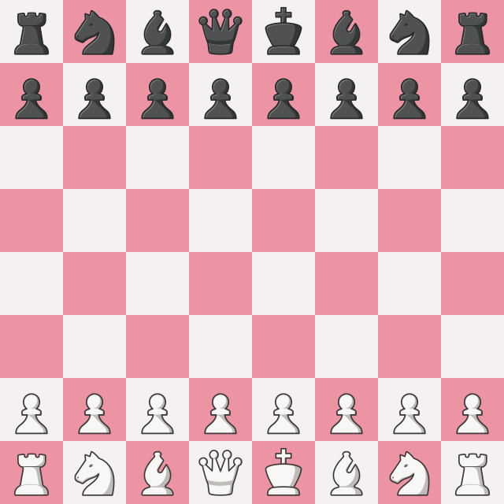
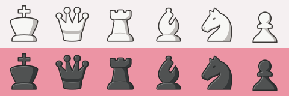
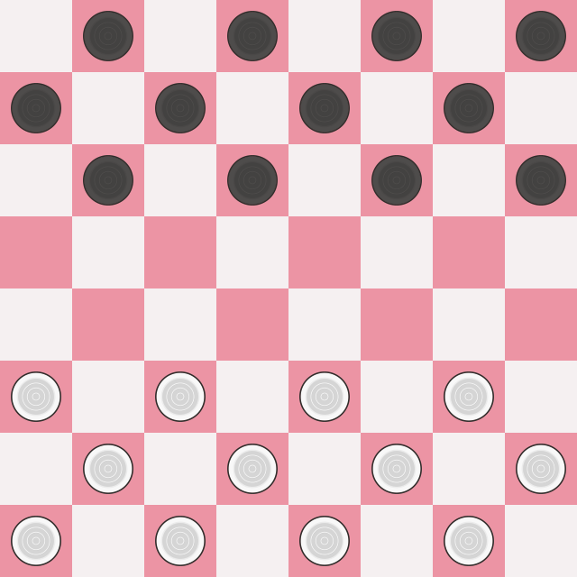
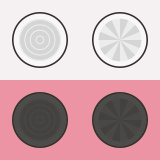

# Sahne-Chess-Checkers-Pieces

Sahne, a free chess & checkers piece set inspired by Sadsnake9's Staunty and Tatiana.

Designed for chess and checkers UIs and interfaces, Sahne brings together soft
curves, cream-white and charcoal-black finishes, clear outlines, and restrained
shading. Both games share one collection and one [MIT License](LICENSE).

## Chess



Familiar Staunton silhouettes have broad bases, rounded contours, and subtle side
shading. Cross-topped kings, pointed queen crowns, split bishop mitres, crenellated
rooks, curved horse heads, and round-headed pawns keep each piece distinct.




| Piece | White | Black |
| --- | --- | --- |
| King | [wk.svg](chess/wk.svg) | [bk.svg](chess/bk.svg) |
| Queen | [wq.svg](chess/wq.svg) | [bq.svg](chess/bq.svg) |
| Rook | [wr.svg](chess/wr.svg) | [br.svg](chess/br.svg) |
| Bishop | [wb.svg](chess/wb.svg) | [bb.svg](chess/bb.svg) |
| Knight | [wn.svg](chess/wn.svg) | [bn.svg](chess/bn.svg) |
| Pawn | [wp.svg](chess/wp.svg) | [bp.svg](chess/bp.svg) |

## Checkers



Rounded discs use concentric rims and subtle shading to suggest depth. Radial
starburst motifs distinguish kings from ordinary men. The American checkers
starting position places 12 black men at the top and 12 white men at the bottom,
all on dark squares.



| Piece | White | Black |
| --- | --- | --- |
| Man | [wm.svg](checkers/wm.svg) | [bm.svg](checkers/bm.svg) |
| King | [wk.svg](checkers/wk.svg) | [bk.svg](checkers/bk.svg) |

Checkers assets are directly inside `checkers/`. SVGs are used by Mintide;
PNG versions are available alongside them.

## Board colors and piece sizes

Both previews use Mintide's **Sahne** palette: cream `#F5F0F1` for light
squares and pink `#EC94A4` for dark squares.

| Piece | Image width and height relative to its square | At an 80 px square |
| --- | --- | --- |
| Chess king, queen, rook, bishop, knight | 90% | 72 × 72 px |
| Chess pawn | 95% | 76 × 76 px |
| Checkers man or king | 90% | 72 × 72 px |

Center the entire SVG image in its square and preserve its aspect ratio. Chess
SVGs have a **100 × 100 viewBox**; checkers SVGs have a **180 × 180 viewBox**.
Both include transparent padding, so the visible silhouette is smaller than the
image box. Keep that internal padding intact without adding more or cropping it.

For an 8 × 8 board of width `B`, each square is `B / 8`. Most image boxes are
`0.90 × B / 8`; chess pawn image boxes are `0.95 × B / 8`. Keep these ratios
when resizing the board for desktop or mobile interfaces.

```html
<div class="square light">
  
</div>
<div class="square dark">
  
</div>
<div class="square dark">
  
</div>
```

```css
.square {
  position: relative;
  display: flex;
  align-items: center;
  justify-content: center;
  width: 80px;
  aspect-ratio: 1;
}
.square.light { background: #F5F0F1; }
.square.dark  { background: #EC94A4; }
.piece {
  position: absolute;
  width: 90%;
  height: 90%;
  object-fit: contain;
  pointer-events: none;
  user-select: none;
}
.piece.pawn { width: 95%; height: 95%; }
```

## Repository layout

```text
README.md           Shared documentation for both games
LICENSE             MIT license for the Sahne collection
chess/              12 chess SVGs and board/set previews
checkers/           4 checkers SVGs, PNG versions, and board/set previews
```

Use this folder as the root of the **Sahne-Chess-Checkers-Pieces** repository.
The game folders keep assets with the same filenames, such as `wk.svg`, distinct.

## Inspiration and license

Sahne is inspired by **Sadsnake9's Staunty and Tatiana** piece sets. Its soft,
sculpted style is intended for game boards, analysis tools, game viewers, and
other chess and checkers interfaces.

The Sahne chess and checkers piece assets, documentation, and previews in this
collection are released under the [MIT License](LICENSE). You may use, modify,
and redistribute them in personal or commercial interfaces, subject to the
license's copyright and permission notice requirements. This license covers
the Sahne collection and does not change the surrounding Mintide application's
license.
